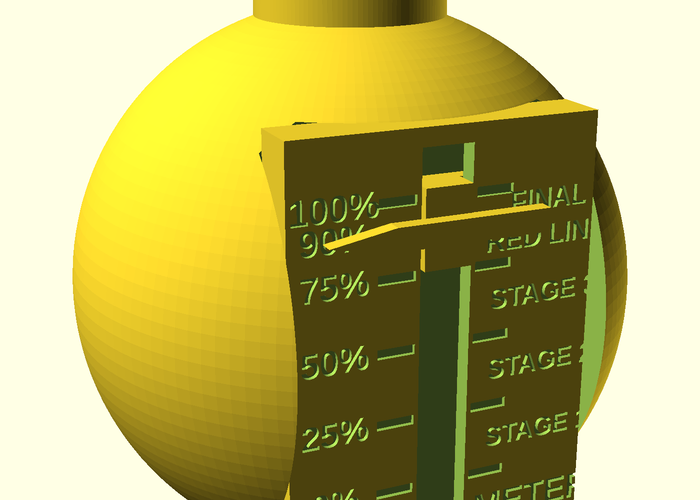
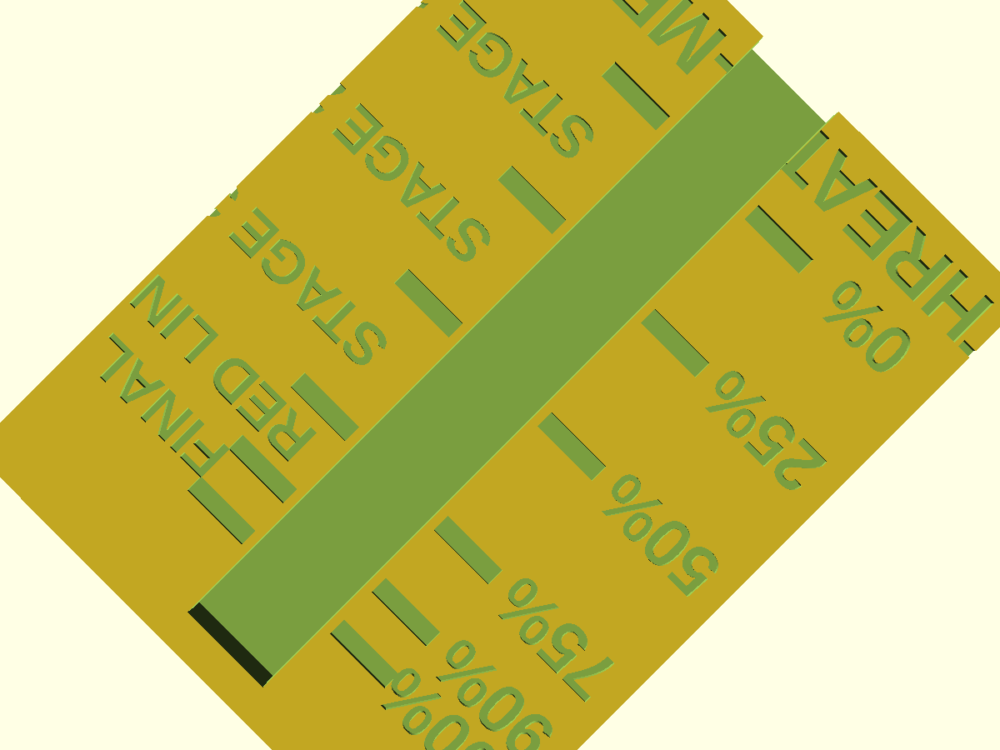
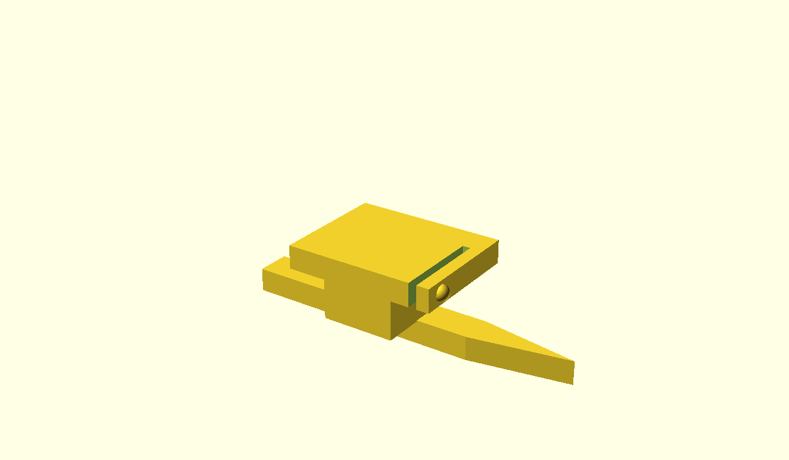

# ACME Cartoon Bomb — "THREAT-O-METER"

A 3D-printable, family-friendly cartoon prop: the classic round ACME bomb,
plus an adjustable **sliding red line** that snaps along an engraved
threat-level track on its face. Draw your own red line at 90% — or crank it
all the way to FINAL.

A parody desk toy (yes, that one — the 2012 UN diagram). Nothing about it is
a real anything.



## Parts

| File | Part | Notes |
|------|------|-------|
| `stl/bomb_body.stl` | Bomb body | Sphere with a flattened base (stands on its own), a fuse-cap socket on top, and a recessed face pocket for the track. |
| `stl/fuse_cap.stl` | Fuse cap + nub | Presses into the top socket; underside is dished to seat on the sphere. |
| `stl/track.stl` | Slotted track | Panel that drops into the face pocket. T-slot channel + engraved marks: `0% 25% 50% 75% 90% 100%`, stages `STAGE 1`–`3`, `RED LINE`, `FINAL`, and a `THREAT-O-METER` title. |
| `stl/slider.stl` | Red-line indicator | Prints in red. T-tongue rides inside the channel; a cantilevered spring finger clicks into a divot at every mark. |
| `stl/assembly_preview.stl` | Preview | Whole bomb in one mesh — for fit-checking / slicing previews only, **not** for printing. |




## Build the STLs

Everything comes from one parametric source file, `bomb.scad`
(OpenSCAD ≥ 2021.01):

```sh
./build_stls.sh                 # writes stl/*.stl
```

or one part at a time:

```sh
openscad -o stl/bomb_body.stl  -D 'part="body"'   bomb.scad
openscad -o stl/fuse_cap.stl   -D 'part="cap"'    bomb.scad
openscad -o stl/track.stl      -D 'part="track"'  bomb.scad
openscad -o stl/slider.stl     -D 'part="slider"' bomb.scad
```

Previews: `part="assembly"` (whole bomb, slider parked at `demo_pct`) and
`part="section"` (cutaway through the channel for fit checks).

## Print guide

| Part | Orientation | Notes |
|------|-------------|-------|
| `bomb_body` | As exported — flat base down. | No supports needed. |
| `fuse_cap` | As exported — stem down, dome up. | No supports. |
| `track` | As exported — flat, engraved face up. | No supports. The channel is open at the bottom edge for insertion. |
| `slider` | As exported — red-line bar face down on the bed (best finish on the visible face). | No supports. Print in **red** — it is, after all, the red line. |

Suggested settings: 0.2 mm layers, 3–4 walls / ~20% infill (the body
appreciates a bit of heft), PLA or PETG. PETG gives the spring finger a
longer life; PLA works fine too — the flex needed is small.

Assembly: press the track plate into the face pocket (a dot of glue keeps it
put), push the fuse cap stem into the top socket, then slide the red-line
indicator into the bottom of the channel until it clicks into the first
detent. Move it up and down to set today's threat level.

If the slider is too tight or too loose on your printer/filament, tweak
`clearance` (default 0.30 mm) and rebuild — that one parameter governs all
slider/track fits.

## Parameters

All sizes are millimetres at the top of `bomb.scad`. The knobs you're most
likely to touch:

| Parameter | Default | What it does |
|-----------|---------|--------------|
| `bomb_radius` | 45 | Overall size (90 mm ball). Scale-friendly: most other dimensions are absolute, so small radius changes are safest. |
| `base_flat` | 0.42 | Flat-base chord radius as a fraction of `bomb_radius` — higher = bigger footprint. |
| `clearance` | 0.30 | Slider/track play. 0.20 = snug, 0.40 = loose. |
| `detents` / `detent_bump_r` / `detent_div_r` | `true` / 0.8 / 0.75 | Click-stops. Turn `detents` off for a friction slider, or tune bump/divot size for a harder/softer snap. |
| `markings` / `engrave_depth` | `"engrave"` / 0.7 | `"emboss"` raises the markings instead of cutting them (nice with a filament swap for colour). |
| `mark_pos` / `mark_labels` / `stage_labels` | see file | Mark positions (fractions of travel), % captions, and stage captions — rename the stages freely. |
| `slot_open_w`, `slot_inner_w`, `slot_inner_d` | 8 / 16 / 3 | Channel cross-section. |
| `track_width` / `track_height` / `track_thick` | 48 / 64 / 8.4 | Panel size. |
| `cap_*`, `socket_*`, `fuse_*` | see file | Fuse cap, socket, and nub dimensions. |
| `title_text` | `"THREAT-O-METER"` | Panel title. |
| `demo_pct` | 0.9 | Where the red line sits in the `assembly` preview. It had to be 90%. |
| `font_name` | Liberation Sans Bold | Engraving font — any installed font works. |

## License

MIT — see [LICENSE](LICENSE). It's a parody toy; print responsibly.
